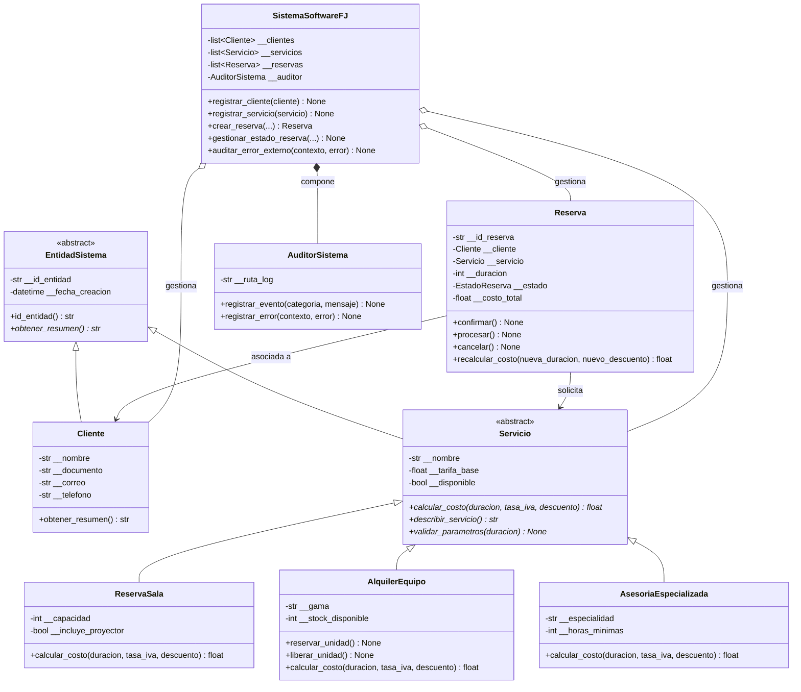

# Software FJ — Sistema de Gestión de Reservas y Servicios
 
Proyecto desarrollado para la **Fase 4 — Componente Práctico (Prácticas Simuladas)** del curso de **Programación** en la **Universidad Nacional Abierta y a Distancia (UNAD)**.
 
## Integrantes
 
* **Richard Smith Sánchez Ortega** (`@rsso2025`) — Arquitectura POO, modelado de dominio, manejo de excepciones y sistema de auditoría.
* **Daniel Martínez** (`@DEMO11-01`) — Administración del repositorio, pruebas de aseguramiento de calidad (QA) y documentación técnica.
 
---
 
## Descripción del Proyecto
 
**Software FJ** es una aplicación modular en **Python** diseñada bajo los principios de la Programación Orientada a Objetos (POO) para administrar clientes, portafolio de servicios empresariales y reservas sin utilizar bases de datos externas. Toda la persistencia operativa se gestiona en memoria mediante colecciones encapsuladas, acompañada de trazabilidad completa en un archivo de registro (`sistema_fj.log`).
 
---
 
## Estructura del Repositorio
 
```text
ProF4/
├── docs/                  # Informe técnico final de la Fase 4 (PDF)
├── auditoria.py           # Módulo de registro de eventos y errores en archivo .log
├── entidades.py           # Clase abstracta EntidadSistema y entidad Cliente validada
├── excepciones.py         # Jerarquía de excepciones personalizadas de negocio
├── gestor.py              # Controlador central en memoria (SistemaSoftwareFJ)
├── main.py                # Simulación integral con 16 operaciones (válidas y de borde)
├── reservas.py            # Clase Reserva con máquina de estados y recálculo dinámico
├── servicios.py           # Clase abstracta Servicio y subclases polimórficas
├── sistema_fj.log         # Evidencia de auditoría generada tras la ejecución
├── .gitignore             # Exclusión de archivos temporales de Python (__pycache__)
└── README.md              # Documentación técnica y arquitectura del sistema
```
 
---
 
## Pilares de POO y Características Técnicas
 
1. **Abstracción:** Definición de las clases base abstractas `EntidadSistema` (`entidades.py`) y `Servicio` (`servicios.py`) mediante el módulo estándar `abc`, obligando a implementar contratos comunes (`obtener_resumen()`, `calcular_costo()`, `describir_servicio()` y `validar_parametros()`).
2. **Encapsulación Estrictra:** Uso de atributos privados (`__documento`, `__correo`, `__tarifa_base`, `__estado`, entre otros) protegidos mediante propiedades (`@property` y `@setter`) con validación por expresiones regulares y reglas de negocio.
3. **Herencia y Polimorfismo:** Jerarquía multinivel donde `ReservaSala`, `AlquilerEquipo` y `AsesoriaEspecializada` heredan de `Servicio` y calculan tarifas, recargos y validaciones de forma especializada.
4. **Sobrecarga de Métodos:** Implementada en `calcular_costo()` y `recalcular_costo()` mediante argumentos opcionales (`tasa_iva`, `descuento`, `nuevo_descuento`) para soportar cotizaciones base, con impuestos o con descuentos dinámicos.
5. **Máquina de Estados y Control de Stock:** Gestión segura del ciclo de vida de cada reserva (`PENDIENTE` → `CONFIRMADA` → `PROCESADA` / `CANCELADA`), bloqueando transiciones inválidas y restaurando automáticamente el inventario en memoria cuando se cancela un alquiler de equipo.
6. **Manejo y Encadenamiento de Excepciones:** Uso de bloques completos `try / except / else / finally` y propagación contextual de errores mediante `raise ... from ...`.
 
---
 
## Diagrama de Clases UML
 

 
---
 
## Ejecución y Pruebas
 
### Requisitos
* **Python 3.10** o superior (no requiere librerías externas).
 
### Pasos para ejecutar la simulación
 
1. Clonar el repositorio:
   ```bash
   git clone [https://github.com/DEMO11-01/ProF4.git](https://github.com/DEMO11-01/ProF4.git)
   cd ProF4
   ```
 
2. Ejecutar el script principal:
   ```bash
   python main.py
   ```
 
3. **Resultados esperados:**
   * En consola se ejecutará una batería de **16 operaciones** que validan registros exitosos, cálculos polimórficos, recálculo dinámico de tarifas, flujo completo de estados, liberación de inventario al cancelar y captura controlada de errores (documentos inválidos, duplicados, tarifas negativas, falta de stock, horas mínimas incumplidas y entidades inexistentes).
   * Se actualizará el archivo **`sistema_fj.log`** con el detalle cronológico de cada transacción y excepción capturada.